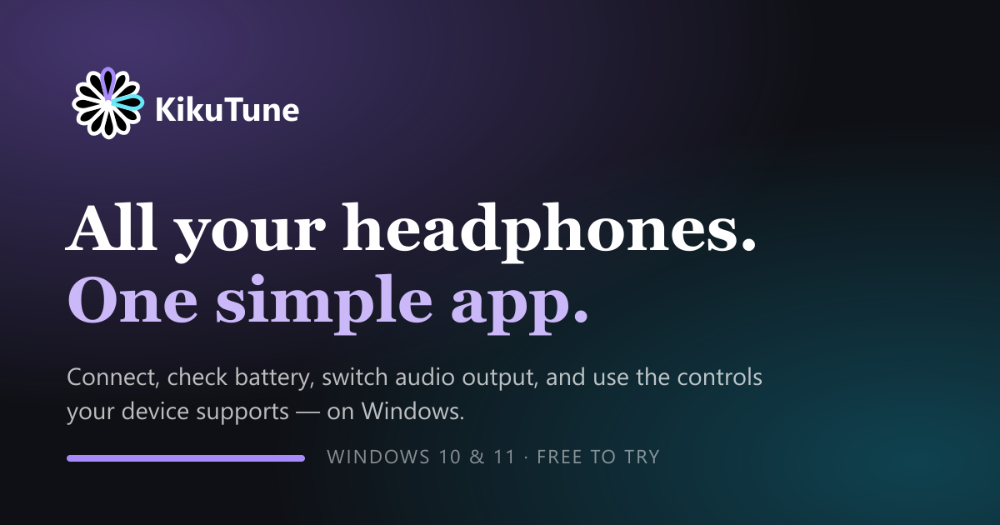
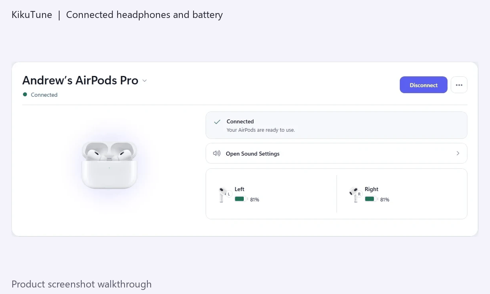
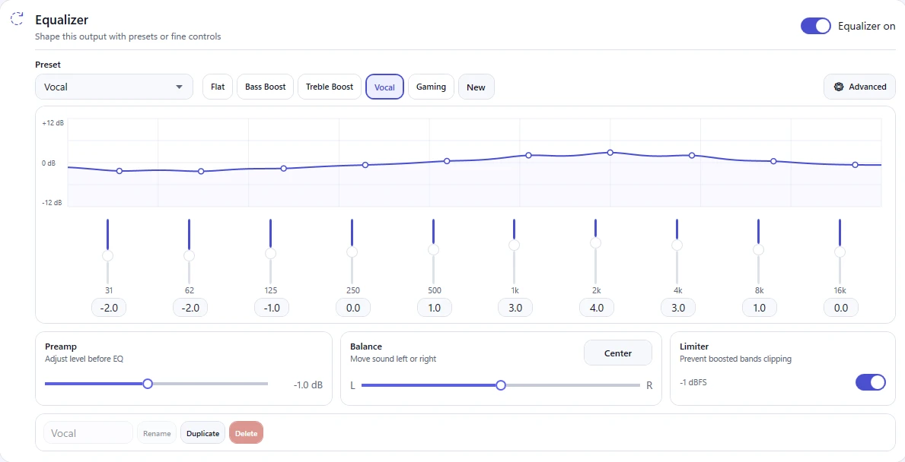

<div align="center">
  
  <h1>KikuTune — AirPods &amp; Headphones Control for Windows 11</h1>
  <p><strong>Battery monitoring, one-click audio output switching, Smart Pause, Hands-Free audio protection, and an equalizer with KikuTune Bridge.</strong></p>
  <p>
    <a href="https://apps.microsoft.com/detail/9NKKD1FDNLPM"></a>
  </p>
  <p>
    <a href="https://kikutune.com">Official website</a> ·
    <a href="https://github.com/DarrosHere/KikuTune/releases/latest">Download Bridge with Noise Control</a> ·
    <a href="https://kikutune.com/guides">Guides</a> ·
    <a href="https://github.com/DarrosHere/KikuTune/issues/new/choose">Feedback &amp; support</a>
  </p>
</div>

## Why KikuTune?

Windows can play audio through Bluetooth headphones. KikuTune brings their everyday controls together in a lightweight Windows app and system tray companion.

- **Live battery levels:** see left earbud, right earbud, and charging case readings when your headphones expose them. Other devices may report a single battery level.
- **Hands-Free audio protection:** detect and help recover from the low-quality mono profile Windows can select when an app uses your Bluetooth microphone. Using a PC or USB microphone lets your headphones stay on stereo output where Windows supports it.
- **One-click output switching:** move playback between headphones, speakers, and your monitor; connect supported devices and access connection recovery tools.
- **Release to iPhone:** release a supported headphone connection from Windows so you can reconnect on your phone. Reconnection depends on the phone and headphones.
- **Smart Pause:** pause and resume media through ear detection on supported headphones and compatible media apps.
- **Equalizer with the free KikuTune Bridge:** ten bands, presets, preamp, balance, and a clipping limiter, with settings for each pair of headphones.
- **Choose your Bridge:** the standard Bridge provides Sound Enhancements without a kernel driver or Windows Test Mode. Bridge with Noise Control adds the optional AAP driver for compatible AirPods and requires Windows Test Mode with Secure Boot off.

Core local controls do not require an account. Feature availability depends on the headphone model, firmware, Bluetooth adapter, Windows configuration, and selected audio endpoint.

## See the app



*Animated walkthrough of existing product screenshots, not a live recording of a case opening or a hardware connection.*

<details>
  <summary>Equalizer with KikuTune Bridge</summary>
  <br />
  
</details>

## Supported devices

KikuTune includes device families for AirPods, Beats, Sony, Bose, JBL, and other Windows Bluetooth audio devices. This is a capability guide, not a guarantee that every model exposes every feature.

| Device family | What to expect |
| --- | --- |
| **Apple AirPods / AirPods Pro / AirPods Max** | Model-dependent battery readings, output switching, Hands-Free protection, and supported ear-detection / release controls. Case and individual-earbud telemetry depend on the model and connection state. |
| **Beats** | Output switching and available battery / media controls; individual-earbud readings depend on the model. |
| **Sony WH / WF series** | Output switching, Hands-Free protection, and battery information where exposed. |
| **Bose QuietComfort / NC series** | Output switching, Hands-Free protection, and battery information where exposed. |
| **JBL and other Bluetooth audio devices** | Windows audio output switching; battery readings and connection controls where available. |

The Bridge equalizer requires a compatible playback endpoint and Sound Enhancements setup. Replicas and devices using different chipsets may identify as another model or omit telemetry. [Request support for your model](https://github.com/DarrosHere/KikuTune/issues/1) with your actual results.

## Download & installation

### 1. Install KikuTune

Get the main app from the [Microsoft Store](https://apps.microsoft.com/detail/9NKKD1FDNLPM). Store updates and the Bridge are distributed separately.

### 2. Add the optional free Bridge

The GitHub download is **Bridge with Noise Control 1.1.4**, which includes Sound Enhancements and the optional AAP driver. Use **KikuTune 1.2.0 or later** from Microsoft Store. For Sound Enhancements without the driver, choose **standard Bridge 1.0.4** on the [official Bridge page](https://kikutune.com/bridge).

1. Download **KikuTuneBridgeNoiseControlSetup-1.1.4.exe** from [GitHub Releases](https://github.com/DarrosHere/KikuTune/releases/latest).
2. Verify the SHA-256 below, then run the installer. Installation requests administrator permission.
3. Review the Noise Control requirements: the test-signed driver needs **Windows Test Mode and Secure Boot off**. The installer explains the changes, requires agreement and may request a restart. Follow the [Bridge installation guide](https://kikutune.com/bridge); Secure Boot must be changed manually in firmware settings when required.
4. Open KikuTune. Compatible AirPods can use Noise Control and AAP ear detection. Set up Sound Enhancements separately for headphones you want to equalize; that setup requests administrator permission once per pair.

The Bridge runs as the signed-in user, starts at sign-in, and communicates locally with KikuTune. Version 1.1.4 stops leaving temporary status files in ProgramData and keeps the Noise Control mode you choose; 1.1.3 fixed AAP initialization after a fresh Windows boot. BLE-only ear detection retains model-dependent limitations. Remove the Bridge through **Settings → Apps** when no longer needed.

### Verify your download

In PowerShell, open the folder containing your download and run:

```powershell
Get-FileHash .\KikuTuneBridgeNoiseControlSetup-1.1.4.exe -Algorithm SHA256
```

Expected SHA-256:

```text
AF2FB6CD34CBEB364B520776847303B4BC7701974DA0875225AC9A062FB6A9DC
```

This is the same installer hosted at the [official versioned download URL](https://download.kikutune.com/bridge/1.1.4/KikuTuneBridgeNoiseControlSetup-1.1.4.exe). Its complete file hash was checked against the locally tested installer.

**Windows SmartScreen:** this Bridge installer is not code-signed, so Windows may display “Windows protected your PC.” Check the source and hash first. If you choose to continue, SmartScreen may offer **More info → Run anyway**. Smart App Control or a managed PC policy may block unsigned software outright; the Bridge may be unavailable on that PC.

## Guides & documentation

- [AirPods Pro on Windows: what actually works](https://kikutune.com/guides/airpods-pro-on-windows)
- [Pair AirPods with Windows 11 and troubleshoot pairing](https://kikutune.com/guides/pair-airpods-with-windows-11)
- [Noise cancellation controls on Windows](https://kikutune.com/guides/airpods-noise-cancellation-windows)
- [Bridge setup and installation](https://kikutune.com/bridge)
- [Changelog](CHANGELOG.md)

## Feedback & community

- [Request headphone support or report battery detection issues](https://github.com/DarrosHere/KikuTune/issues/1)
- [Feature suggestions & feedback](https://github.com/DarrosHere/KikuTune/issues/2)
- [Report a bug or request a feature](https://github.com/DarrosHere/KikuTune/issues/new/choose)
- [Join Discussions](https://github.com/DarrosHere/KikuTune/discussions)
- Contact: **support@kikutune.com**

This repository contains public documentation, support templates, media, and Bridge release downloads. Application source code is not published here.

KikuTune is independent software operated by Andrii Herasym under the KikuLabs brand. It is not affiliated with Apple, Microsoft, Sony, Bose, JBL, or other device makers. Product names and trademarks belong to their respective owners.
